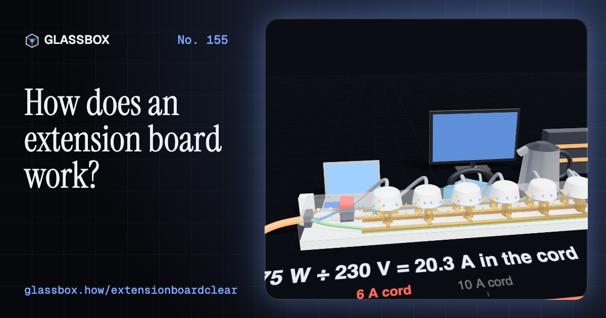
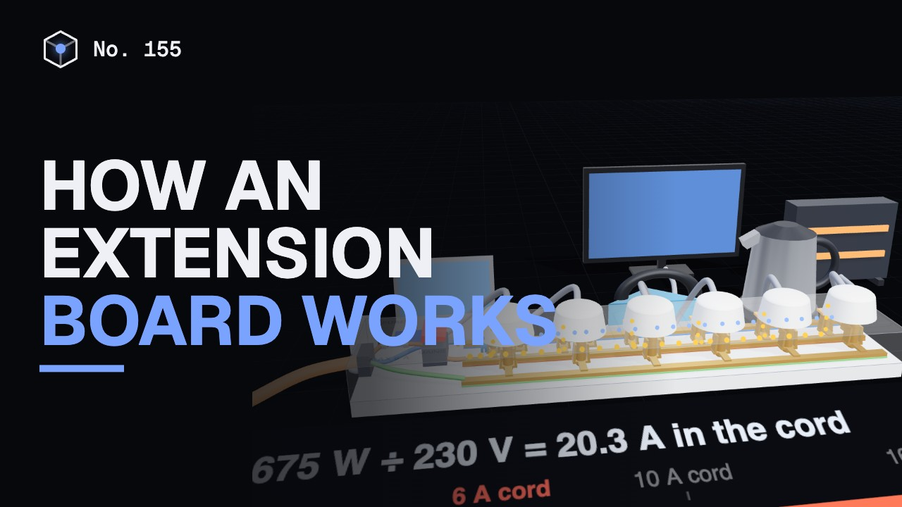
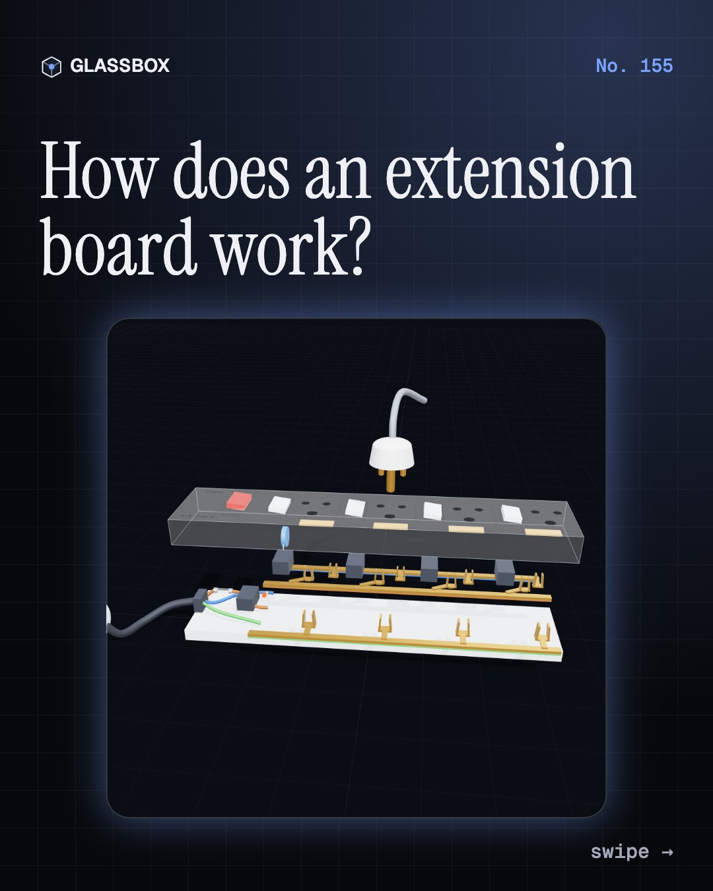
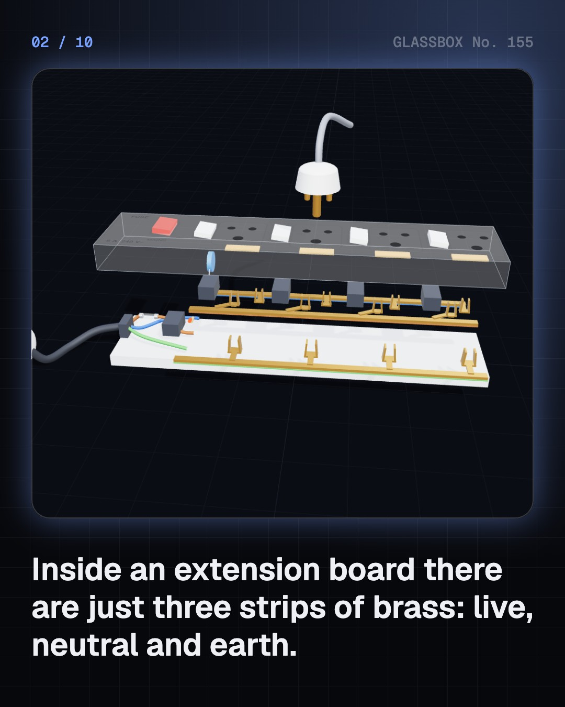
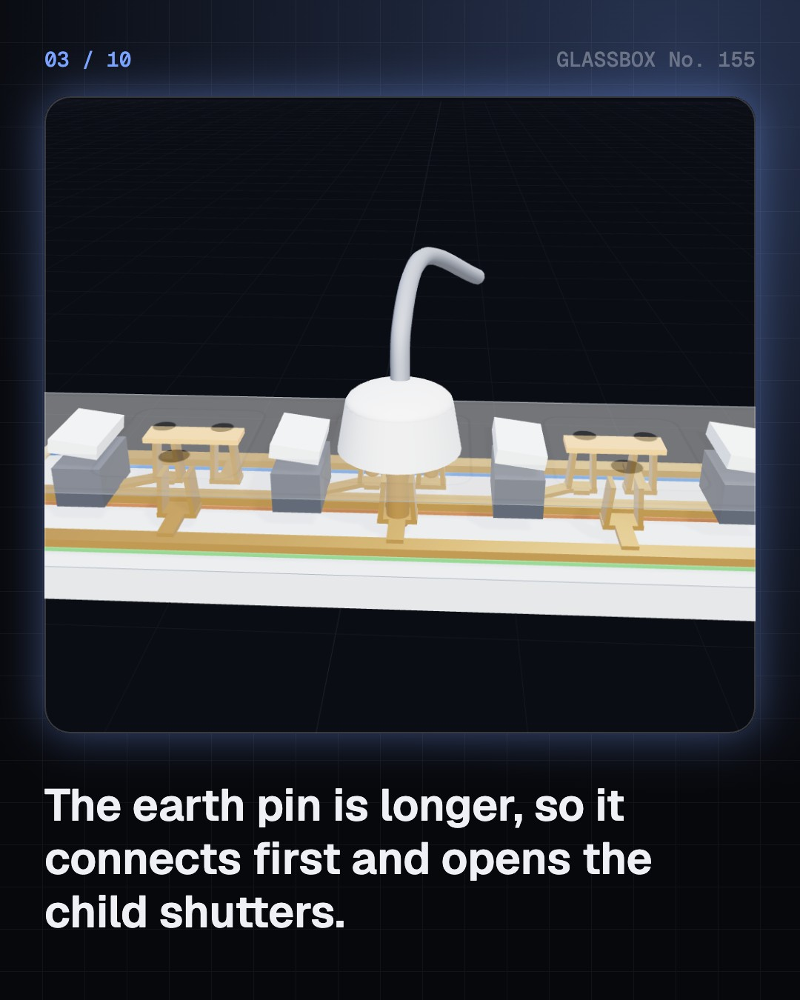
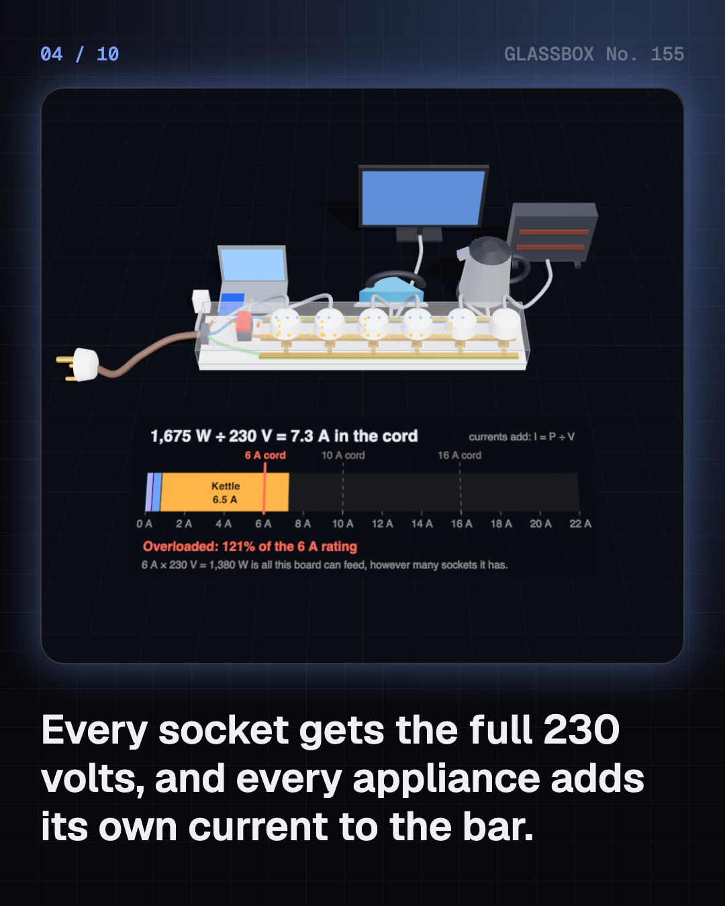

<!-- glassbox:start -->
<!-- Generated from glassbox.json by the Glassbox hub (npm run readme -- extensionboardclear). Edit glassbox.json, not this block. -->
<p align="center"><a href="https://glassbox.how/e/extensionboardclear/"></a></p>

<h1 align="center">ExtensionBoardClear</h1>

<p align="center"><b>How does an extension board work?</b><br>Inside every extension board are just three strips of brass. Plug in a kettle, an iron and a heater and watch 20 amps squeeze through a cord made for 6, see why a coiled reel cooks, and find out what a spike guard really guards against.</p>

<p align="center"><a href="https://glassbox.how/extensionboardclear/"><b>▶ Play with it</b></a> &nbsp;·&nbsp; <a href="https://glassbox.how/e/extensionboardclear/">Read the 60-second explainer</a> &nbsp;·&nbsp; <a href="https://glassbox.how/extensionboardclear/glassbox/reel.mp4">Watch the 40-second video</a></p>

<p align="center">
  <a href="https://glassbox.how/e/extensionboardclear/"></a>
  <a href="https://glassbox.how/e/extensionboardclear/"></a>
  <a href="LICENSE"></a>
  <a href="LICENSE-CONTENT.md"></a>
  <a href="#privacy"></a>
</p>

## In 60 seconds

1. **Three strips of brass.** Inside the board, three brass bus bars run its whole length: live, neutral and earth. Every socket is three spring clips on those same bars. The cord's live core passes through a fuse and the master switch first. On an Indian IS 1293 plug the earth pin is 20.6 mm long against 14.9 mm, so earth connects first and pushes the child shutters open.
2. **Everything in parallel.** Every socket gets the full 230 V, and each appliance draws its own current, I = P ÷ V. A phone charger takes 0.04 A, a 1,500 W kettle 6.5 A. The currents add on the bar and the whole total comes down one cord. A 6 A board can feed about 1,380 W in all, a 16 A one 3,680 W, however many sockets it has.
3. **Why cords get hot.** A cord is a long, thin resistor: about 0.026 Ω per metre in each core of a 0.75 mm² cord. Heat is I²R, so double the current makes four times the heat. Coiled on a reel or under a carpet that heat cannot escape. A loose contact of 0.2 Ω at 10 A makes 20 W in a spot the size of a pea, and nothing trips.
4. **The wall MCB does not guard the cord.** The board's own fuse or bimetal breaker follows a time-current curve: minutes for a small overload, a blink for a big one. The 16 A MCB in the wall is sized for the wall wiring and carries 18 A for an hour, long after a thin 6 A cord has passed 70 °C. Only a short circuit of hundreds of amps trips it at once.
5. **Spikes and the third pin.** A spike guard's blue disc is a varistor. At 230 V it leaks a few microamps; above about 430 V it conducts thousands of amps and clamps a spike to under 1,000 V. Every hit wears it and it cannot survive a long over-voltage. The earth pin does a different job: it carries fault current away so an RCCB, fuse or MCB can cut the power.
6. **Read the label, not the name.** An extension board is sockets on a cord. A spike guard adds a fuse and one small varistor. A surge protector states its clamping voltage and joules. Only a UPS has a battery. None stops a shock: that needs earth and an RCCB. Look for the ISI mark with IS 1293 and IS 694, add up the watts, unwind reels and never chain boards.

## Words worth knowing

| Term | Meaning |
|---|---|
| **Bus bar** | A metal strip that many things connect to. An extension board has three: live, neutral and earth. |
| **Parallel circuit** | Loads connected across the same two wires, so each gets the full voltage and their currents add. |
| **Rated current** | The current a cord, plug or board is built to carry all day: 6 A, 10 A or 16 A. Times 230 V gives the watts. |
| **I²R heating** | The heat made in any resistance: current squared times resistance. It is why overloaded cords and loose contacts get hot. |
| **Time-current curve** | A graph of how long a fuse or breaker waits at each current: minutes for small overloads, milliseconds for short circuits. |
| **Thermal breaker** | A push-to-reset switch opened by a bimetal strip that bends as the current warms it. |
| **Varistor (MOV)** | A zinc oxide disc that is nearly an insulator at mains voltage and conducts hard above about 430 V, clamping spikes. |
| **Earthing** | Connecting metal cases to the ground through the third pin, so a fault current has a path and a protector can trip. |
| **ISI mark** | The Bureau of Indian Standards mark with an IS number, such as IS 1293 for plugs and sockets and IS 694 for PVC cords. |

## A short history

**About 140 years from appliances screwed into lamp sockets to a strip of sockets with a fuse, a varistor and a standard of its own.**

- **1881** · The lamp socket becomes the first outlet (Thomas Edison, Menlo Park, New Jersey, USA)
- **1904** · The plug you can pull out (Harvey Hubbell, Bridgeport, Connecticut, USA)
- **1915** · The earth pin is made longer (George P. Knapp for Harvey Hubbell; British Engineering Standards Association, USA and United Kingdom)
- **1928** · A grounded plug for American homes (Philip F. Labre, USA)
- **1934** · BS 546: the round-pin family India still uses (British Standards Institution, London, England)
- **1968** · The zinc oxide varistor (Michio Matsuoka and colleagues, Matsushita Electric, Osaka, Japan)
- **1972** · The power board, famously unpatented (Peter Talbot, working under Frank Bannigan at Kambrook, Australia)
- **2022** · Short-circuit fires in the national figures (National Crime Records Bureau, India)

The full story, with 28 moments, charts, people and 33 sources: [glassbox.how/e/extensionboardclear/history](https://glassbox.how/e/extensionboardclear/history/). The data lives in [`history.json`](history.json).

## Video and slides

Made with the Glassbox studio from this box's storyboard (`window.glassbox.director`). Free to reuse under CC BY 4.0.

<a href="https://glassbox.how/extensionboardclear/glassbox/video.mp4"></a>

<p><a href="glassbox/slide-1.jpg"></a> <a href="glassbox/slide-2.jpg"></a> <a href="glassbox/slide-3.jpg"></a> <a href="glassbox/slide-4.jpg"></a></p>

| File | What | Size |
|---|---|---|
| [`glassbox/reel.mp4`](https://glassbox.how/extensionboardclear/glassbox/reel.mp4) | Reel / Short, with captions and soundtrack | 1080×1920 |
| [`glassbox/video.mp4`](https://glassbox.how/extensionboardclear/glassbox/video.mp4) | YouTube video, with captions and soundtrack | 1920×1080 |
| `glassbox/slide-1…10.jpg` | Instagram carousel | 1080×1350 |
| `glassbox/thumb.jpg` | YouTube thumbnail | 1280×720 |
| `glassbox/cover.jpg` | Share card and repo social preview | 1200×630 |
| [`glassbox/history-reel.mp4`](https://glassbox.how/extensionboardclear/glassbox/history-reel.mp4) | “History in 10 moments” Reel / Short | 1080×1920 |
| `glassbox/history-slide-*.jpg` | History carousel | 1080×1350 |
| `glassbox/post.json` | Post copy and schedule used by the publish kit | |

## Privacy

This box has no accounts and no ads, and it ships its own fonts and libraries. When you run it yourself it sends nothing anywhere. On glassbox.how, the site's `/bar.js` also loads Glassbox's analytics: **Google Analytics** to count visits (it asks first in the EU, UK and Switzerland, and stays off when your browser sends Global Privacy Control or Do Not Track) and **ClickTrust** to detect bots.

It remembers a few things **in your own browser only**, and never sends them anywhere:

| Browser storage key | What it holds |
|---|---|
| `extensionboardclear.v1` | Which chapters you have opened, your best quiz scores, and sound on or off. |

Exactly what each one sees is at [glassbox.how/privacy](https://glassbox.how/privacy/).

## Licences

- **Code:** [MIT](LICENSE). Use it, change it, ship it.
- **Explanations, text, images and videos** (`glassbox.json`, `glassbox/`): [CC BY 4.0](LICENSE-CONTENT.md). Credit “Glassbox, glassbox.how/e/extensionboardclear”.
- **Third-party parts** keep their own licences: [three.js](https://threejs.org) (MIT), [Geist, Instrument Serif](https://openfontlicense.org) (SIL OFL 1.1).
- The Glassbox name and logo aren't covered by either licence. See the [terms](https://glassbox.how/terms/).

Found a mistake? [Open an issue](https://github.com/bdeeps/extensionboardclear/issues). Corrections happen in public.
<!-- glassbox:end -->

## Run it

It's plain HTML, CSS and JavaScript. No build step and no dependencies. Run locally, it contacts no other website.

```bash
python3 -m http.server 8000
```

Three.js and the fonts ship in `vendor/` and `fonts/`, so it also works offline.

Then open http://localhost:8000.

## How it's built

| File | What |
|---|---|
| `index.html`, `css/app.css` | The page and its styles |
| `js/app.js`, `js/stage.js`, `js/ui.js`, `js/kit.js` | The shared Glassbox 3D engine: chapters, 3D stage, controls, quiz, video director |
| `js/chapters/*.js` | One file per chapter: the 3D model, controls, text, key terms, quiz and video scenes |
| `js/ext.js` | ExtensionBoardClear's shared physics and parts: flexible-cord tables (IEC 60228), the cord heating model (straight, coiled, covered), fuse, thermal-breaker and MCB time-current models, the varistor model, shock figures shared with MCBClear, and 3D models of a generic extension board, a three-pin plug and simple appliances |
| `glassbox.json` | Title, question, explainer beats, key terms, browser storage and credits shown on glassbox.how |
| `reel` in each chapter | The storyboard the Glassbox studio records into short videos |
| `glassbox/` | The published video, slides, thumbnail and post copy |
| `fonts/`, `vendor/three/` | Self-hosted Geist and Instrument Serif (SIL OFL 1.1) and three.js (MIT) |
